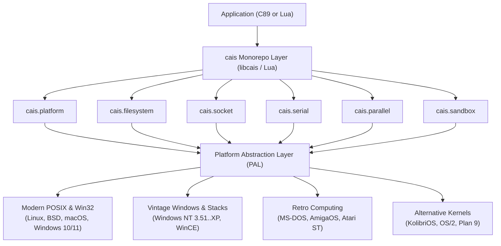

# cais

<p align="center">
  <strong>Lightweight, modular C89 and Lua systems programming library for modern and vintage operating systems.</strong>
</p>

---

## Overview

**`cais`** is an operating system abstraction library written in strict **ANSI C89 (ISO C90)** with ergonomic **Lua** bindings. It provides a cohesive, unified systems API covering modern and retro operating systems spanning four decades of computing history.

Whether you are targeting **Linux**, **FreeBSD**, **macOS**, **Windows 11**, **Windows NT 3.51**, **MS-DOS**, **AmigaOS**, **Atari ST**, **KolibriOS**, **OS/2**, or **Plan 9**, `cais` exposes identical semantics, canonical types, and runtime guarantees.



---

## Core Subsystems

| Subsystem | Description | Lua Module | C Header |
| :--- | :--- | :--- | :--- |
| **`platform`** | Architecture, OS detection, bitness, endianness metadata | `require("cais.platform")` | [`cais/platform.h`](file:///home/gustavo/Projetos/cais/include/cais/platform.h) |
| **`filesystem`** | Safe filesystem manipulation, recursion, streaming (alias: `fs`) | `require("cais.fs")` | [`cais/filesystem.h`](file:///home/gustavo/Projetos/cais/include/cais/filesystem.h) |
| **`socket`** | Raw TCP & UDP IPv4 sockets, native `poll(2)` and dynamic `WSAPoll` | `require("cais.socket")` | [`cais/socket.h`](file:///home/gustavo/Projetos/cais/include/cais/socket.h) |
| **`serial`** | RS-232 UART driver, baud rates, parity, modem control lines | `require("cais.serial")` | [`cais/serial.h`](file:///home/gustavo/Projetos/cais/include/cais/serial.h) |
| **`parallel`** | IEEE 1284 Centronics printer port, raw pin access, strobe timing | `require("cais.parallel")` | [`cais/parallel.h`](file:///home/gustavo/Projetos/cais/include/cais/parallel.h) |
| **`sandbox`** | Kernel-level sandboxing (Linux Landlock, OpenBSD Pledge, Capsicum) | `require("cais.sandbox")` | [`cais/sandbox.h`](file:///home/gustavo/Projetos/cais/include/cais/sandbox.h) |

---

## Quick Example: Sockets

=== "C (ANSI C89)"

    ```c
    #include <stdio.h>
    #include <cais/cais.h>

    int main(void) {
        char err_buf[128];
        cais_socket_t *sock;
        size_t sent = 0;

        sock = cais_socket_connect("127.0.0.1", 8080, CAIS_SOCK_BLOCKING, err_buf, sizeof(err_buf));
        if (!sock) {
            fprintf(stderr, "Connection failed: %s\n", err_buf);
            return 1;
        }

        if (cais_socket_send(sock, "PING\n", 5, &sent) == CAIS_SOCK_OK) {
            printf("Sent %lu bytes\n", (unsigned long)sent);
        }

        cais_socket_close(sock);
        return 0;
    }
    ```

=== "Lua"

    ```lua
    local cais = require("cais")

    local client, err = cais.socket.connect("127.0.0.1", 8080)
    if not client then
        error("Connection failed: " .. tostring(err))
    end

    client:write("PING\n")
    client:close()
    ```

---

## Guiding Principles

1. **Strict ANSI C89 (ISO C90) Public Surface:** Clean interop with antique compilers (Open Watcom, MSVC 4.0, vbcc, Aztec C) without breaking modern C99/C11/C++ toolchains.
2. **Deterministic Canonical Types:** No raw integers as pseudo-booleans. Canonical types like `cais_bool_t`, `cais_status_t`, and `cais_line_state_t` enforce compile-time clarity.
3. **Zero Dynamic Allocation on Common Paths:** Critical I/O routines (such as event multiplexing) utilize stack-allocated scratch buffers for up to 64 descriptors.
4. **Retro Without Compromise:** Windows NT 3.51, MS-DOS, AmigaOS, and Atari ST are first-class targets, not abandoned emulations.
