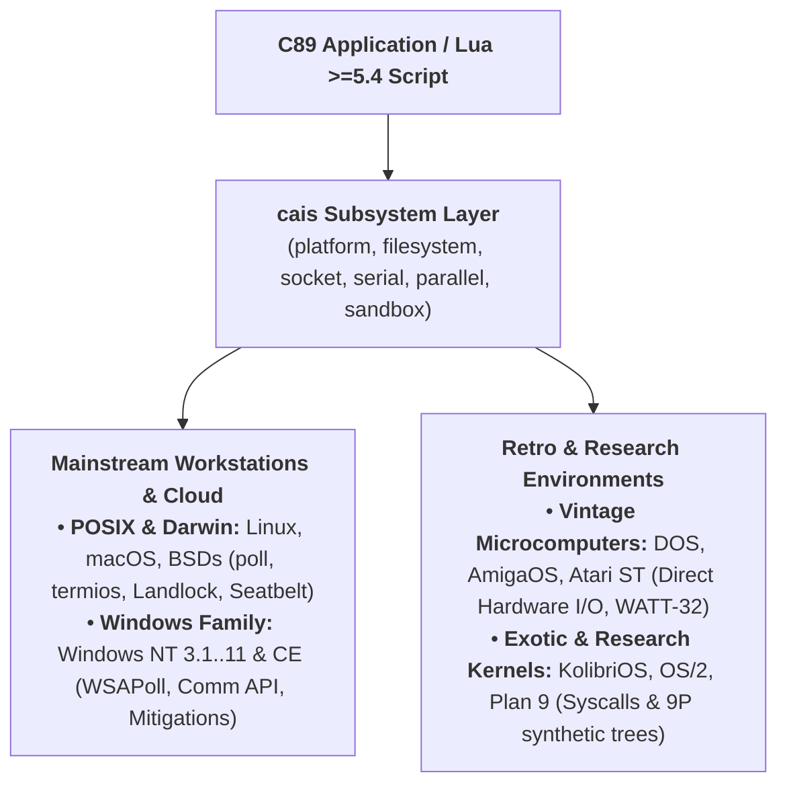

# Platform Architecture & Support Directory

`cais` is engineered to provide a single, unified C89 and Lua systems programming substrate across more than **ten distinct operating system families**, spanning over three decades of computing history (1985–2026).

Rather than restricting itself to a lowest-common-denominator subset of POSIX, `cais` features a **Pluggable Platform Abstraction Layer (PAL)**. The library communicates natively with host operating system kernels, BIOS interrupts, hardware chipsets, and synthetic filesystem trees, offering zero-bloat portability across 16-bit, 32-bit, and 64-bit architectures.

---

## 🏛️ How `cais` Subsystems Adapt Across Operating Systems

Every subsystem in `cais` is designed around a clean conceptual boundary, delegating to specialized native drivers depending on the host architecture:

### 1. Host Identification & Metadata (`cais.platform`)
* **Role:** Compile-time and runtime introspection of CPU architecture, bitness, endianness, and operating system family.
* **Mechanism:** Evaluates compiler built-in macros (`__x86_64__`, `__m68k__`, `_WIN32`, `__amigaos__`) without triggering expensive system calls or runtime memory allocations.
* **Endianness Predicates:** Provides unambiguous Big-Endian (Motorola 68k, SPARC, PowerPC) and Little-Endian (x86, ARM, RISC-V) validation.

### 2. Filesystem & Path Operations (`cais.filesystem`)
* **Role:** Directory traversal, path canonicalization, file streaming, and metadata interrogation.
* **Modern POSIX & BSD:** Standard POSIX.1-2001 directory streams (`opendir`, `readdir`, `stat`).
* **Windows NT & CE:** Win32 file handles (`CreateFileA` on NT; automatic UTF-8 to UTF-16 wide-character bridging on Windows CE).
* **MS-DOS & FreeDOS:** Direct DOS API file handle manipulation (`_dos_open`, `_dos_read`, `_dos_findfirst`).
* **AmigaOS:** Native AmigaDOS file lock operations (`Lock()`, `Examine()`, `ExNext()`).
* **Atari ST:** GEMDOS file search routines (`Fsfirst()`, `Fsnext()`).
* **Plan 9:** Synthetic namespace navigation using native file descriptors and `dirread`.

### 3. Network Sockets & Multiplexing (`cais.socket`)
* **Role:** Stream TCP, datagram UDP, non-blocking I/O, and asynchronous descriptor multiplexing.
* **Modern POSIX, macOS & BSDs:** Standard BSD Sockets with linear array multiplexing via `poll(2)`, bypassing legacy `FD_SETSIZE` limits.
* **Windows NT & CE:** Adaptive Winsock 2 driver: invokes native `WSAPoll` dynamically on Windows Vista/11, or automatically falls back to Winsock `select()` (configured with `#define FD_SETSIZE 1024`) on Windows NT 3.51..XP.
* **MS-DOS Protected Mode:** Waterloo TCP/IP (WATT-32) stack integration over hardware packet drivers.
* **AmigaOS & AROS:** Dynamic binding to `bsdsocket.library` (compatible with Roadshow, MiamiDX, and AmiTCP).
* **Atari ST FreeMiNT:** MiNTNet BSD socket device streams.
* **KolibriOS:** Direct kernel-gate networking via Syscall 75.
* **Plan 9:** Synthetic network hierarchies under `/net/tcp` and `/net/udp` (`clone`, `ctl`, `data`).

### 4. Serial Port RS-232 Driver (`cais.serial`)
* **Role:** Physical asynchronous serial communication (baud rate, parity, stop bits, flow control, modem lines).
* **POSIX & Darwin:** Standard POSIX `termios` configuration over `/dev/tty*` and `/dev/cu.*` device nodes.
* **Windows NT & CE:** Win32 Communications API (`SetCommState`, `GetCommModemStatus`) for `COM1`..`COM9` and `\\.\COM10+`.
* **MS-DOS:** Direct hardware I/O port manipulation of the National Semiconductor 8250 / 16550 UART chips (`0x3F8`, `0x2F8`) and BIOS `INT 14h`.
* **AmigaOS:** Native Amiga `serial.device` Exec I/O request packets and Paula UART chipset control.
* **Atari ST:** Direct memory-mapped register configuration of the Motorola MFP 68901 UART (`0xFFFFFA01`).
* **IBM OS/2:** Kernel asynchronous communications via `DosDevIOCtl` (Category 1).
* **Plan 9:** Human-readable text control streams via `/dev/eia0ctl` (e.g. `"b115200"`, `"l8"`, `"pn"`).

### 5. Centronics Parallel Port IEEE 1284 (`cais.parallel`)
* **Role:** Hardware line printer data transmission and hardware status pin interrogation (Busy, Ack, Paper Out, Error).
* **Linux:** Linux line printer character devices (`/dev/lp0`..`/dev/lp2`).
* **Windows NT & CE:** Win32 parallel port drivers (`LPT1`..`LPT3`).
* **MS-DOS:** Direct parallel port strobe toggling (`0x378`, `0x278`) and BIOS `INT 17h` print service.
* **AmigaOS:** Native Amiga `parallel.device` Exec I/O requests handled by CIA 8520 chips.
* **Atari ST:** Centronics handshaking through Port A of the Yamaha YM2149 sound chip and MFP strobe GPIO.
* **macOS:** Safely reports `CAIS_PARALLEL_UNSUPPORTED` (`-4`) with zero runtime overhead (hardware absent on Apple Macintosh).

### 6. Kernel Sandboxing & Confinement (`cais.sandbox`)
* **Role:** Irrevocable application sandboxing based on unified declarative policies.
* **Linux:** Linux Landlock LSM (ABIs 1 to 5) with `prctl(PR_SET_NO_NEW_PRIVS)`.
* **macOS Darwin:** Apple Seatbelt MAC framework via dynamic TinyScheme SBPL synthesis and `sandbox_init()`.
* **Windows NT:** Dynamic resolution of `SetProcessMitigationPolicy` (prohibiting child processes, enforcing W^X dynamic code memory hardening, and strict handle checking).
* **OpenBSD:** Automatic path confinement via `unveil(2)` and syscall promise filtering via `pledge(2)`.
* **FreeBSD:** Strict capability mode via `cap_enter(2)` (Capsicum).
* **Vintage & Retro Platforms:** Graceful fallback reporting `CAIS_SANDBOX_UNSUPPORTED` (`-4`).

---

## 🧭 Dedicated Platform Directory

Explore the dedicated documentation, hardware driver specifications, and implementation details for each target platform:

| Platform Family | Key Architecture & Subsystem Highlights |
| :--- | :--- |
| [**Linux (Modern & Embedded)**](linux.md) | Modern LTS & embedded (glibc, musl, uClibc, bionic), Landlock LSM ABI 1–5, `poll(2)`. |
| [**macOS (Darwin & Apple Silicon)**](macos.md) | Apple Silicon (arm64), Intel, and PowerPC (G4/G5); Seatbelt SBPL sandboxing via `sandbox_init()`. |
| [**Windows NT & CE**](windows.md) | 30 years of Windows (NT 3.1..11, CE 3.0+), dynamic `WSAPoll`, 1024-handle `select`, Process Mitigations. |
| [**OpenBSD**](openbsd.md) | Security-first OS; automatic `unveil(2)` path confinement and synthesized `pledge(2)` promises. |
| [**FreeBSD**](freebsd.md) | Capsicum capability mode (`cap_enter`), high-concurrency BSD sockets, `/dev/lpt*`. |
| [**NetBSD & DragonFly BSD**](netbsd.md) | Unmatched architecture portability (alpha, vax, m68k, sparc, x86_64); HAMMER & SMP on DragonFly. |
| [**MS-DOS & FreeDOS**](dos.md) | 16-bit Real Mode & 32-bit Protected Mode (DJGPP, DOS/4GW), WATT-32 TCP/IP, direct 8250 UART. |
| [**Commodore AmigaOS & AROS**](amigaos.md) | Motorola 68000..68060 & AROS; AmigaDOS lock packets, `parallel.device`, `serial.device`, `bsdsocket.library`. |
| [**Atari ST (TOS & FreeMiNT)**](atarist.md) | TOS & FreeMiNT; direct MFP 68901 UART registers, Yamaha YM2149 Centronics strobe, MiNTNet BSD sockets. |
| [**KolibriOS**](kolibrios.md) | Pure x86 assembly OS; Syscall 46 direct port strobe/UART and Syscall 75 IPv4 network stack. |
| [**IBM OS/2 & ArcaOS**](os2.md) | 32-bit flat memory model; `DosOpen` LPT devices, `DosDevIOCtl` asynchronous serial, IBM TCP/IP Sockets. |
| [**Plan 9 from Bell Labs & 9front**](plan9.md) | 9P synthetic directory trees; `/net/tcp` socket hierarchy, `/dev/eia*ctl` text commands, `/dev/lp`. |
| [**Kernel Internals & Gotchas**](internals.md) | Deep technical breakdown of syscalls, buffer management, and platform quirks. |

---

## 🏛️ Comprehensive Driver & Subsystem Matrix

> **Universal Baseline Subsystem:** `cais.platform` (host OS identification, CPU architecture, bitness, and endianness) is **supported across 100% of all target platforms**.

| Platform Family | Filesystem (`fs`) | Parallel (`parallel`) | Serial (`serial`) | Sockets (`socket`) | Sandboxing (`sandbox`) |
| :--- | :--- | :--- | :--- | :--- | :--- |
| [**Linux (Modern & Embedded)**](linux.md) | ✅ POSIX | ✅ `/dev/lp*` | ✅ termios | ✅ BSD / `poll(2)` | ✅ Landlock LSM |
| [**OpenBSD**](openbsd.md) | ✅ POSIX | ✅ `/dev/lpt*` | ✅ termios | ✅ BSD / `poll(2)` | ✅ Pledge & Unveil |
| [**FreeBSD**](freebsd.md) | ✅ POSIX | ✅ `/dev/lpt*` | ✅ termios | ✅ BSD / `poll(2)` | ✅ Capsicum mode |
| [**NetBSD & DragonFly BSD**](netbsd.md) | ✅ POSIX | ✅ `/dev/lpt*` | ✅ termios | ✅ BSD / `poll(2)` | ⚠️ Safe Stub (`-4`) |
| [**macOS (Darwin)**](macos.md) | ✅ POSIX | ⚠️ Safe Stub | ✅ termios | ✅ BSD / `poll(2)` | ✅ Seatbelt SBPL |
| [**Windows NT (10 / 11 / Server)**](windows.md) | ✅ Win32 | ✅ Win32 LPT | ✅ Comm API | ✅ `WSAPoll` dynamic | ✅ Mitigations (1607+) |
| [**Windows NT (3.51..XP / 7)**](windows.md) | ✅ Win32 | ✅ Win32 LPT | ✅ Comm API | ✅ Winsock `select` (1024) | ⚠️ Safe Stub (`-4`) |
| [**Windows CE 3.0..6.0 (ARM/MIPS)**](windows.md) | ✅ WinCE W | ✅ WinCE LPT | ✅ Comm API | ✅ Winsock CE | ⚠️ Safe Stub (`-4`) |
| [**MS-DOS (16/32-bit WATT-32)**](dos.md) | ✅ DOS io | ✅ `INT 17h` / I/O | ✅ `INT 14h` / 8250 | ✅ WATT-32 TCP/IP | ⚠️ Safe Stub (`-4`) |
| [**AmigaOS (m68k / AROS)**](amigaos.md) | ✅ Lock DOS | ✅ `parallel.device` | ✅ `serial.device` | ✅ `bsdsocket.library` | ⚠️ Safe Stub (`-4`) |
| [**Atari ST (TOS / MiNT)**](atarist.md) | ✅ Fsfirst | ✅ Hardware I/O | ✅ MFP 68901 UART | ✅ MiNTNet Sockets | ⚠️ Safe Stub (`-4`) |
| [**KolibriOS (x86)**](kolibrios.md) | ⚠️ Safe Stub | ✅ Syscall 46 / I/O | ✅ Syscall 46 / UART | ✅ Syscall 75 | ⚠️ Safe Stub (`-4`) |
| [**OS/2 / ArcaOS**](os2.md) | ✅ access | ✅ DosOpen LPT | ✅ DosDevIOCtl | ✅ TCP/IP BSD | ⚠️ Safe Stub (`-4`) |
| [**Plan 9 from Bell Labs**](plan9.md) | ✅ access | ✅ `/dev/lp` | ✅ `/dev/eia*` | ✅ `/net/tcp` | ⚠️ Safe Stub (`-4`) |

---

## ⏱️ Minimum Operating System Versions

The table below outlines the minimum operating system version required for core library execution, as well as specific milestone releases where advanced subsystem features become active:

| Operating System Family | Minimum OS for Core (`cais`) | Advanced Subsystem Milestones & Requirements |
| :--- | :--- | :--- |
| [**Linux**](linux.md) | **Linux 2.0+** (libc5 / glibc 2.0) | • **`poll(2)` multiplexing:** Linux 2.1.23+ • **Landlock v1 (Filesystem):** Linux 5.13+ • **Landlock v2 (Refer):** Linux 5.19+ • **Landlock v3 (Truncate):** Linux 6.2+ • **Landlock v4 (TCP Network):** Linux 6.7+ • **Landlock v5 (IOCTL dev):** Linux 6.12+ |
| [**macOS (Darwin)**](macos.md) | **Mac OS X 10.0** (Cheetah, 2001) | • **PowerPC Support:** Mac OS X 10.0 até 10.5 Leopard (última versão compatível com PowerPC; 10.6 Snow Leopard tornou-se exclusivamente Intel) • **Seatbelt Sandboxing (`sandbox_init`):** Mac OS X 10.5+ (Leopard) • **Dynamic event polling:** macOS 10.3+ (`poll(2)`) |
| [**Windows NT**](windows.md) | **Windows NT 3.1** (1993) | • **Filesystem, Serial, LPT:** Windows NT 3.51+ (1995) • **Adaptive `WSAPoll`:** Windows Vista / Server 2008+ • **Process Mitigations (W^X / Handles):** Windows 8.1+ • **Child Process Restrictions:** Windows 10 Version 1607+ |
| [**Windows CE**](windows.md) | **Windows CE 3.0** (Pocket PC 2000) | • **Filesystem (`*W` Unicode):** CE 3.0+ • **Networking:** Winsock for CE 3.0+ |
| [**OpenBSD**](openbsd.md) | **OpenBSD 2.0** (1996) | • **`pledge(2)` syscall restrictions:** OpenBSD 5.9+ (2016) • **`unveil(2)` filesystem confinement:** OpenBSD 6.4+ (2018) |
| [**FreeBSD**](freebsd.md) | **FreeBSD 3.0** (1998) | • **Capsicum capability mode (`cap_enter`):** FreeBSD 10.0+ (2014) |
| [**MS-DOS**](dos.md) | **MS-DOS 3.30** (1987) | • **Networking (WATT-32 32-bit TCP/IP stack):** 386+ protected mode (DJGPP / Open Watcom DOS/4GW) |
| [**AmigaOS**](amigaos.md) | **AmigaOS 1.2 / 1.3** (1986) | • **Parallel & Serial drivers:** AmigaOS 1.2+ (`parallel.device`, `serial.device`) • **Networking:** AmigaOS 2.04+ with AmiTCP / Miami (`bsdsocket.library`) |
| [**Atari ST**](atarist.md) | **TOS 1.00** (1985) | • **Filesystem & Hardware I/O:** GEMDOS / TOS 1.0+ • **Networking:** FreeMiNT 1.12+ with MiNTNet socket stack |
| [**OS/2 / ArcaOS**](os2.md) | **OS/2 2.0** (1992) | • **Networking:** OS/2 Warp 3.0+ with TCP/IP stack |
| [**KolibriOS**](kolibrios.md) | **KolibriOS 0.7.7.0+** | • **Raw I/O & UART:** Syscall 46 • **Networking:** Syscall 75 (Stack IP v4) |
| [**Plan 9 from Bell Labs**](plan9.md) | **Plan 9 3rd / 4th Edition** | • **Networking:** Native `/net/tcp` and `/net/udp` synthetic file trees |

---

## 🛡️ Runtime Feature Degradation Model

`cais` guarantees that an application compiled with support for advanced features will **never crash with missing dynamic symbols or loader failures** when deployed on an older release within the same OS family:

1. **Windows:** `WSAPoll` and `SetProcessMitigationPolicy` are probed at runtime via `GetProcAddress`. When missing on Windows XP or Windows 7, `cais` safely falls back to `select()` (with expanded 1024-handle arrays) or returns `CAIS_SANDBOX_UNSUPPORTED` (`-4`).
2. **Linux:** Landlock syscall availability is probed via `syscall(__NR_landlock_create_ruleset, NULL, 0, LANDLOCK_CREATE_RULESET_VERSION)`. If Landlock is uncompiled or the kernel predates 5.13, `cais` cleanly reports unsupported.
3. **OpenBSD / FreeBSD:** Syscall support is checked via probe invocations (`pledge(NULL, NULL)` and `sysctlbyname("kern.features.capsicum")`).
