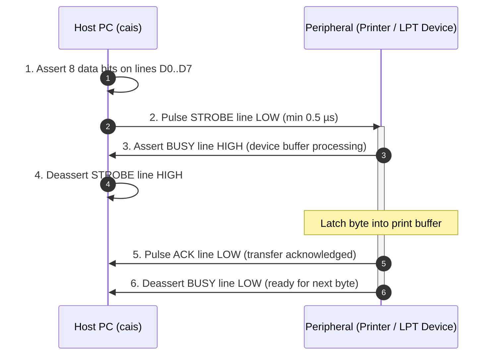

# Parallel Port (IEEE 1284) (`cais.parallel`)

The `parallel` subsystem provides low-level and high-level control of physical Centronics and IEEE 1284 parallel printer ports (LPT).

It abstracts 8-bit parallel bus communication across modern operating systems and vintage microcomputers, supporting legacy dot-matrix impact printers, point-of-sale (POS) thermal receipt printers, and custom embedded bit-banged hardware.

---

## ⚡ 1. Hardware Architecture & Centronics Protocol

Unlike serial communication which transmits bits sequentially over a single wire, parallel ports transmit an **entire 8-bit byte simultaneously** across eight physical data lines (D0..D7), synchronized by dedicated control and status handshake lines.

### 1.1 The Classic Centronics Handshake Cycle

A complete byte transfer follows a strict hardware handshaking protocol:



1. **Data Setup:** The host places the 8-bit byte on data pins `D0..D7`.
2. **Strobe Pulse:** The host asserts the `STROBE#` line logic `LOW` for at least 0.5 µs to signal that valid data is on the bus.
3. **Busy Assertion:** The peripheral detects the strobe, latches the data, and immediately asserts the `BUSY` line logic `HIGH`.
4. **Strobe Release:** The host returns `STROBE#` to logic `HIGH`.
5. **Acknowledge Pulse:** Once the peripheral has stored the byte into its internal FIFO, it emits a negative pulse on `ACK#` (typically 5 µs).
6. **Ready State:** The peripheral pulls `BUSY` back to logic `LOW`, signaling that it is ready to accept the next character.

---

### 1.2 DB-25 & Centronics Pinout Reference

The standard PC parallel interface connects a host **DB-25** connector to a peripheral 36-pin **Centronics** connector. Active-low signals are designated with the standard `#` suffix:

| Signal       | DB-25  | Centronics |  Dir   | Function & Electrical Logic                                 |
| :----------- | :----: | :--------: | :----: | :---------------------------------------------------------- |
| `STROBE#`    |   1    |     1      |  Out   | Clock pulse latching data into peripheral (Active Low)      |
| `D0..D7`     |  2..9  |    2..9    | In/Out | 8-bit bidirectional parallel data bus                       |
| `ACK#`       |   10   |     10     |   In   | Handshake pulse acknowledging byte receipt (Active Low)     |
| `BUSY`       |   11   |     11     |   In   | High when peripheral is processing, buffer full, or offline |
| `PE`         |   12   |     12     |   In   | Paper End: High when printer is out of paper                |
| `SLCT`       |   13   |     13     |   In   | Select: High when printer is powered on and online          |
| `AUTOFD#`    |   14   |     14     |  Out   | Automatic line feed after carriage return (Active Low)      |
| `FAULT#`     |   15   |     32     |   In   | Error: Low on paper jam, cover open, or fault (Active Low)  |
| `INIT#`      |   16   |     31     |  Out   | Hardware reset pulse to printer controller (Active Low)     |
| `SELECT_IN#` |   17   |     36     |  Out   | Host selects peripheral for communication (Active Low)      |
| `GND`        | 18..25 |   19..30   |   —    | Signal ground reference return lines                        |

---

### 1.3 PC Hardware Register Architecture (Base Port 0x378 / 0x278)

On PC architectures (DOS, Windows, OS/2, Linux raw I/O), the hardware maps these signals across three 8-bit I/O registers:

| Register             |    Address Offset    |  I/O Access  | Mapped Signals & Inversions                                                                                        |
| :------------------- | :------------------: | :----------: | :----------------------------------------------------------------------------------------------------------------- |
| **Data Register**    | `Base + 0` (`0x378`) | Read / Write | `D0..D7` (Pins 2..9). Writing outputs 8 bits onto the bus.                                                         |
| **Status Register**  | `Base + 1` (`0x379`) |  Read-Only   | Inputs from peripheral: `BUSY` (bit 7, inverted), `ACK#` (bit 6), `PE` (bit 5), `SLCT` (bit 4), `FAULT#` (bit 3).  |
| **Control Register** | `Base + 2` (`0x37A`) | Read / Write | Outputs to peripheral: `SELECT_IN#` (bit 3, inv), `INIT#` (bit 2), `AUTOFD#` (bit 1, inv), `STROBE#` (bit 0, inv). |

---

### 1.4 IEEE 1284 Operating Modes

Standardized in 1994, IEEE 1284 defined five backward-compatible operational modes:

| Mode Identifier             | Mode Name                           | Bandwidth  |          Directionality          | Description                                                                                                         |
| :-------------------------- | :---------------------------------- | :--------: | :------------------------------: | :------------------------------------------------------------------------------------------------------------------ |
| `CAIS_PARALLEL_MODE_SPP`    | Standard Parallel Port (Centronics) | ~150 KB/s  |     Unidirectional (Forward)     | Classic compatibility mode. Software-driven strobe/ack for printers.                                                |
| `CAIS_PARALLEL_MODE_NIBBLE` | IEEE 1284 Nibble Mode               |  ~50 KB/s  |  Bidirectional (Reverse 4-bit)   | Reads data back from peripheral using 4 status lines (`BUSY`, `PE`, `SLCT`, `FAULT`). Works on all hardware.        |
| `CAIS_PARALLEL_MODE_BYTE`   | IEEE 1284 Byte Mode (PS/2)          | ~500 KB/s  |  Bidirectional (Reverse 8-bit)   | Tri-states data drivers to read 8-bit bytes in reverse over lines D0..D7.                                           |
| `CAIS_PARALLEL_MODE_EPP`    | Enhanced Parallel Port              |  ~2 MB/s   | Bidirectional (Asynchronous Bus) | Hardware auto-generates strobe cycles. Designed for external drives (Iomega ZIP, scanners).                         |
| `CAIS_PARALLEL_MODE_ECP`    | Extended Capabilities Port          | ~2..4 MB/s |    Bidirectional (DMA / FIFO)    | High-speed protocol featuring hardware 16-byte FIFO, Run-Length Encoding (RLE) data compression, and DMA transfers. |

---

## 🔌 2. Platform Device Path Conventions

Parallel devices are addressed differently depending on the operating system:

| Operating System Family        | Device Path Syntax                                            | Examples                       |
| :----------------------------- | :------------------------------------------------------------ | :----------------------------- |
| **Linux**                      | `/dev/parport*` (raw ppdev) or `/dev/lp*` (character printer) | `/dev/parport0`, `/dev/lp0`    |
| **FreeBSD / OpenBSD / NetBSD** | `/dev/lpt*` (printer) or `/dev/ppi*` (general purpose)        | `/dev/lpt0`, `/dev/lpt1`       |
| **Windows NT / 2000..11**      | `LPT1`, `LPT2`, `LPT3`, `PRN`                                 | `LPT1`, `PRN`                  |
| **Windows CE**                 | `LPT1:`, `LPT2:`                                              | `LPT1:`                        |
| **MS-DOS / FreeDOS**           | `LPT1`, `LPT2`, `PRN` or direct I/O base address              | `LPT1`, `0x378`, `0x278`       |
| **Commodore AmigaOS**          | `parallel.device`                                             | `parallel.device`              |
| **Atari ST (TOS / FreeMiNT)**  | `PRT:`, Centronics port                                       | `PRT:`                         |
| **IBM OS/2 Warp**              | `LPT1`, `LPT2`, `PRN`                                         | `LPT1`                         |
| **Plan 9 from Bell Labs**      | `#p/lp` (data), `#p/lpctl` (control)                          | `/dev/lp`, `#p/lp`             |
| **KolibriOS**                  | Direct LPT port address                                       | `0x378` (LPT1), `0x278` (LPT2) |

---

## ⚙️ 3. Constants & Enumerations

### 3.1 Status Register Pin Bitmasks (`cais_parallel_pin_t`)

Returned by `cais_parallel_get_status()` or queried through Lua predicate methods:

| C Constant                | Lua Field (`cais.parallel.pin`) |      Bitmask      | Description                                            |
| :------------------------ | :------------------------------ | :---------------: | :----------------------------------------------------- |
| `CAIS_PARALLEL_PIN_BUSY`  | `BUSY`                          | `1 << 0` (`0x01`) | Device is busy processing, buffer full, or offline     |
| `CAIS_PARALLEL_PIN_ACK`   | `ACK`                           | `1 << 1` (`0x02`) | Acknowledge pulse line                                 |
| `CAIS_PARALLEL_PIN_PE`    | `PE` / `PAPER_OUT`              | `1 << 2` (`0x04`) | **Paper End:** Printer is completely out of paper      |
| `CAIS_PARALLEL_PIN_SLCT`  | `SLCT` / `ONLINE`               | `1 << 3` (`0x08`) | **Select:** Printer is powered on and online           |
| `CAIS_PARALLEL_PIN_FAULT` | `FAULT`                         | `1 << 4` (`0x10`) | **Fault:** Hardware error, paper jam, or carriage lock |

---

### 3.2 Operating Modes (`cais_parallel_mode_t`)

| C Constant                  | Lua Field (`cais.parallel.mode`) | Value | Description                                       |
| :-------------------------- | :------------------------------- | :---: | :------------------------------------------------ |
| `CAIS_PARALLEL_MODE_SPP`    | `SPP` / `CENTRONICS`             |  `0`  | Standard Centronics Compatibility mode (Forward)  |
| `CAIS_PARALLEL_MODE_NIBBLE` | `NIBBLE`                         |  `1`  | IEEE 1284 4-bit reverse read channel              |
| `CAIS_PARALLEL_MODE_BYTE`   | `BYTE`                           |  `2`  | IEEE 1284 8-bit bidirectional channel (PS/2 mode) |
| `CAIS_PARALLEL_MODE_EPP`    | `EPP`                            |  `3`  | Enhanced Parallel Port bus transfer               |
| `CAIS_PARALLEL_MODE_ECP`    | `ECP`                            |  `4`  | Extended Capabilities Port with hardware FIFO     |

---

### 3.3 Return Status Codes (`cais_parallel_status_t`)

| C Constant                  | Lua Field (`cais.parallel.status`) | Value | Description                                      |
| :-------------------------- | :--------------------------------- | :---: | :----------------------------------------------- |
| `CAIS_PARALLEL_OK`          | `OK`                               |  `0`  | Operation completed successfully                 |
| `CAIS_PARALLEL_ERROR`       | `ERROR`                            | `-1`  | I/O fault, invalid handle, or cable disconnected |
| `CAIS_PARALLEL_UNSUPPORTED` | `UNSUPPORTED`                      | `-4`  | Requested mode or pin query unsupported on host  |

---

## 🏛️ 4. ANSI C89 Function Reference

All public functions are declared in [`include/cais/parallel.h`](file:///home/gustavo/Projetos/cais/include/cais/parallel.h) and are strictly ANSI C89 compliant.

### 4.1 Opening a Parallel Port

```c
cais_parallel_t *cais_parallel_open(
    const char *path, 
    char *err_buf, 
    size_t err_cap
);
```
Opens a physical parallel port device node.
* **Parameters:**
  * `path`: Platform device path (e.g. `"/dev/lp0"`, `"/dev/parport0"`, `"LPT1"`).
  * `err_buf`: Optional pre-allocated buffer receiving error text on failure (zero heap allocation).
  * `err_cap`: Capacity of `err_buf`.
* **Returns:** Active handle to `cais_parallel_t`, or `NULL` on failure.

---

### 4.2 Data Transmission (Forward Centronics)

```c
cais_status_t cais_parallel_write(
    cais_parallel_t *port, 
    const char *buf, 
    size_t len, 
    size_t *written_bytes
);
```
Transmits raw bytes across the 8 data lines (D0..D7) with hardware strobe pulse generation and busy monitoring.
* **Parameters:**
  * `written_bytes`: Optional pointer storing the exact count of bytes accepted by the printer.
* **Returns:** `CAIS_OK` on success, or `CAIS_ERROR` on failure.

---

### 4.3 Data Reception (Reverse IEEE 1284 Channels)

```c
cais_status_t cais_parallel_read(
    cais_parallel_t *port, 
    char *buf, 
    size_t max_len, 
    size_t *read_bytes
);
```
Reads data emitted by an IEEE 1284 compliant peripheral in Nibble, Byte, EPP, or ECP mode.
* **Returns:** `CAIS_OK` on data, `CAIS_UNSUPPORTED` if host hardware does not support reverse reading, or `CAIS_ERROR` on failure.

---

### 4.4 Hardware Status Pin Introspection

```c
cais_parallel_status_t cais_parallel_get_status(
    cais_parallel_t *port, 
    int *pins_out
);
```
Reads the real-time electrical state of the printer status pins.
* **Parameters:**
  * `pins_out`: Pointer populated with a bitmask combining `CAIS_PARALLEL_PIN_*` flags (`BUSY`, `ACK`, `PE`, `SLCT`, `FAULT`).
* **Returns:** `CAIS_PARALLEL_OK` on success, or `CAIS_PARALLEL_ERROR` on failure.

---

### 4.5 Mode Negotiation & Buffer Drain

```c
/* Negotiates IEEE 1284 operating mode */
cais_parallel_status_t cais_parallel_set_mode(
    cais_parallel_t *port, 
    cais_parallel_mode_t mode
);

/* Waits until printer buffer is empty and BUSY is deasserted */
cais_parallel_status_t cais_parallel_drain(cais_parallel_t *port);
```
* **`cais_parallel_drain`:** Actively monitors the `BUSY` pin until the peripheral finishes physical processing (e.g. printing lines onto paper). Always call before closing the port to prevent truncated printouts.

---

### 4.6 Port Teardown

```c
void cais_parallel_close(cais_parallel_t *port);
```
Releases the parallel port, claims or locks held on Linux `ppdev`, and frees internal driver handles. Safe to pass `NULL`.

---

## 💻 5. Practical C89 Programming Examples

### Example 1: ESC/P Dot-Matrix / Receipt Printer Driver with Out-of-Paper Guard

Checks if paper is present and printer is online before sending an ESC/POS formatting command stream:

```c
#include <cais/parallel.h>
#include <stdio.h>
#include <string.h>

int print_receipt(const char *dev_path, const char *text) {
    char err[128];
    int pins = 0;
    size_t written = 0;
    cais_parallel_t *lpt;

    lpt = cais_parallel_open(dev_path, err, sizeof(err));
    if (!lpt) {
        fprintf(stderr, "Failed to open printer %s: %s\n", dev_path, err);
        return -1;
    }

    /* Verify printer status pins */
    if (cais_parallel_get_status(lpt, &pins) == CAIS_PARALLEL_OK) {
        if (pins & CAIS_PARALLEL_PIN_PE) {
            fprintf(stderr, "ERROR: Printer is OUT OF PAPER!\n");
            cais_parallel_close(lpt);
            return -2;
        }
        if (pins & CAIS_PARALLEL_PIN_FAULT) {
            fprintf(stderr, "ERROR: Printer FAULT (cover open or jam)!\n");
            cais_parallel_close(lpt);
            return -3;
        }
        if (!(pins & CAIS_PARALLEL_PIN_SLCT)) {
            fprintf(stderr, "WARNING: Printer is OFFLINE.\n");
        }
    }

    /* Send ESC @ (Initialize Printer) followed by receipt payload */
    cais_parallel_write(lpt, "\x1B@", 2, &written);
    cais_parallel_write(lpt, text, strlen(text), &written);
    cais_parallel_write(lpt, "\n\n\n\x1Bd\x03", 6, &written); /* Feed 3 lines & cut */

    /* Wait for physical printing to complete */
    cais_parallel_drain(lpt);

    cais_parallel_close(lpt);
    return 0;
}

int main(void) {
    const char receipt[] = 
        "================================\n"
        "       CAIS BISTRO & CAFE       \n"
        "================================\n"
        "1x Espresso Doppio      $ 4.50  \n"
        "1x Croissant Pur Beurre $ 3.80  \n"
        "--------------------------------\n"
        "Total:                  $ 8.30  \n"
        "================================\n";

    if (print_receipt("/dev/lp0", receipt) == 0) {
        printf("Receipt printed successfully!\n");
    }
    return 0;
}
```

---

### Example 2: Bit-Banged 8-Bit Hardware Output (Relay Bank / Stepper Motor)

Writing directly to the parallel data port to drive external TTL electronics:

```c
#include <cais/parallel.h>
#include <stdio.h>

void trigger_relays(cais_parallel_t *lpt, unsigned char relay_bitmask) {
    char byte_val = (char)relay_bitmask;
    size_t written = 0;

    /* Write 8-bit pattern to Data pins D0..D7 */
    if (cais_parallel_write(lpt, &byte_val, 1, &written) == CAIS_OK) {
        cais_parallel_drain(lpt);
        printf("Relay state updated: 0x%02X\n", relay_bitmask);
    }
}
```

---

## 🌙 6. Lua API Reference & Idioms (Lua >= 5.4)

Loaded via `require("cais.parallel")` or through the umbrella table `cais.parallel`.

### 6.1 Constructor (`parallel.open`)

Accepts a device path string or an options table:

```lua
local parallel = require("cais.parallel")

-- Options Table:
local lpt, err = parallel.open({
    path = "/dev/parport0",          -- device node path
    mode = parallel.mode.SPP         -- SPP, NIBBLE, BYTE, EPP, ECP
})

-- String Path Constructor:
local lpt, err = parallel.open("LPT1")
```

---

### 6.2 Port Methods & Predicates

| Method                             | Signatures                    | Description                                                                                             |
| :--------------------------------- | :---------------------------- | :------------------------------------------------------------------------------------------------------ |
| `port:write`                       | `port:write(data_str)`        | Transmits raw bytes. Returns `written_count` or `nil, err`.                                             |
| `port:read`                        | `port:read([max_len = 4096])` | Reads incoming bytes in reverse IEEE 1284 mode. Returns `str` or `nil, err`.                            |
| `port:status` / `port:get_status`  | `port:status()`               | Returns integer bitmask combining `parallel.pin.*` constants, or `nil, err`.                            |
| `port:is_busy`                     | `port:is_busy()`              | Returns `true` if `BUSY` pin is asserted (printer processing or offline).                               |
| `port:is_ack`                      | `port:is_ack()`               | Returns `true` if `ACK` pin is asserted.                                                                |
| `port:is_pe` / `port:is_paper_out` | `port:is_pe()`                | Returns `true` if printer is out of paper.                                                              |
| `port:is_online` / `port:is_slct`  | `port:is_online()`            | Returns `true` if printer is selected and online.                                                       |
| `port:is_fault`                    | `port:is_fault()`             | Returns `true` if hardware fault / paper jam occurred.                                                  |
| `port:set_mode`                    | `port:set_mode(mode_val)`     | Switches IEEE 1284 operating mode. Returns `true` or `false, err`.                                      |
| `port:drain` / `port:flush`        | `port:drain()`                | Waits until printer finishes internal processing. Returns `true` or `false, err`.                       |
| `port:close`                       | `port:close()`                | Closes device handle immediately. (Also executed automatically during garbage collection or `<close>`). |

---

### Example: ESC/POS Thermal Receipt Printer with Paper Monitoring

```lua
local parallel = require("cais.parallel")

local printer, err = parallel.open("/dev/lp0")
if not printer then
    error("Cannot open parallel printer: " .. tostring(err))
end

-- Check hardware status pins using convenient predicate methods
if printer:is_paper_out() then
    error("Printer reports OUT OF PAPER! Please reload paper roll.")
end

if printer:is_fault() then
    error("Printer reports HARDWARE FAULT (cover open or head overheated)!")
end

if not printer:is_online() then
    print("Notice: Printer is currently OFFLINE.")
end

-- Send ESC/POS commands
local ESC = string.char(0x1B)
local GS  = string.char(0x1D)

printer:write(ESC .. "@")              -- Initialize
printer:write(ESC .. "a" .. "\1")      -- Center alignment
printer:write("CAIS RETRO COMPUTING\n")
printer:write("Parallel Subsystem Test\n\n")
printer:write(ESC .. "a" .. "\0")      -- Left alignment
printer:write("Status: Online and Ready\n")
printer:write("Driver: cais.parallel (IEEE 1284)\n\n\n")
printer:write(GS .. "V" .. "\1")       -- Partial paper cut

-- Wait for print buffer to drain onto paper
printer:drain()
printer:close()
print("Print job dispatched and drained successfully.")
```